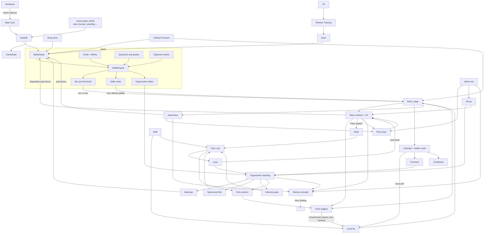

# Phase 2: Mechanics inventory

Commit `b02bbab` plus audit files. Read-only. Labels: **Verified** (ran it), **Inferred** (read from code or data), **Assumed**.

The full variable-level inventory is `audit/mechanics.csv` (1,200 rows: mechanic, variable, value or fill, observed range, where it is defined, which scripts read it, status). It is generated by `audit/tests/static_scan.py` and `audit/tests/build_mechanics_csv.py`, so it can be rebuilt after any change. This document is the map and the findings.

**Limits of the scan (state these with every count):** a name counts as "read" when a script quotes it, builds it from a quoted prefix or suffix (`"win_delta_" + x`, `meter + "_delta"`), or matches a format string. A field reached only through a variable is not seen. So "no reader" means "no literal reader", and I confirmed each one I report below with a separate `grep`.

## 1. Where values live (summary)

| Where | Count | Evidence | Label |
|---|---|---|---|
| Workbook Balance tab (`data/balance.json`) | 270 levers; 269 read by a script, 1 read by nothing (`xp_tiers`) | `audit/tests/results/static_scan.json` | Verified |
| Workbook tables (52 exported JSON files) | 847 fields in the CSV: 792 read, 43 with no literal reader, 12 named only by the loader, 3 empty columns | `audit/mechanics.csv` status column | Verified (scan), see limits |
| **Hand-written JSON (not in the workbook)** | 10 files, 976 values; 123 CSV rows | `tools/export_data.py:4333`; `audit/phase0_orientation.md` section 2 | Verified |
| **Numbers typed into scripts** | 88 numeric constants (77 in UI, 11 in gameplay code) and 139 further lines in gameplay code holding a number literal (candidates) | `static_scan.json` `consts`, `magic` | Verified (count); each needs reading to judge |
| Code defaults that disagree with the workbook | 83 `balance.get("key", N)` calls whose fallback `N` differs from the data | `static_scan.json` `default_mismatch` | Verified |

## 2. Mechanics

"Defined" is where the numbers come from. "Code" is the rules file that owns the behavior. Workbook tabs are named as their JSON export.

### 2.1 Battle

| Mechanic | Variables (value / range in data) | Defined | Code | Reads | Writes / triggers |
|---|---|---|---|---|---|
| Turn loop and energy | `energy_per_turn` 3 to 26 (median 3), `energy_mode`, `energy_pool`; pass costs 1 energy next turn | `stages`; `rules.pass_energy_penalty` (**hand-written**) | `scripts/rules/BattleEngine.gd:558` (`end_turn`), `:772-794` | stage row, rules | energy, turn counter; ends stage on turn limit |
| Hand, deck, draw, discard | `hand_size` 3 to 6; deck 15 + slots; `discard_hand_end_of_turn` | `stages`; `balance.starter_deck_size`; `rules` (**hand-written**) | `BattleEngine.gd:315`, `:1652-1672` | deck from `GameState.deck` | hand, discard |
| Cards | 70 cards; `cost`, `self_plus`, `opp_minus`, `guard`, `draw`, `gaffe`, `special`, `special_value`, `discard_to_play`, `discard_for_draw`, `tier` | `cards` | `scripts/rules/CardResolver.gd:42`; `SpecialEffects.gd:74` | affinity, question grade, audience share, Reputation | support, guard, gaffes, draw |
| Affinity | suit multiplier per room, about 0.5 to 1.5 | `affinity` | `BattleEngine.gd:539` | card suit, stage | multiplies support numbers only |
| Questions and grades | strong 1.3, weak 0.7; `questions_own_share_percent` 34 | `questions`; `balance.question_*` | `BattleEngine.gd:699`, `:1337`, `:1416` | question pool, card suit | card multiplier; organization tallies |
| Guard | cap 5, carries between turns | `rules.guard_cap` (**hand-written**) | `BattleState.gd:47-56` | card guard | absorbs opponent attack |
| Gaffe meter | `gaffe_limit` 2 to 10 (median 5) | `stages` | `BattleEngine.gd:865-871` | card gaffe | loss when full (checked first) |
| Opponent intents | attack / gain / block ranges per opponent; default attack 1-6, gain 1-6, block 0-2 | `opponents.intent_*_range`; `rules.default_intent_pattern` (**hand-written**) | `scripts/rules/IntentRunner.gd:136`; `DataDB.gd:812-820`; `BattleEngine.gd:826` | opponent row | bar, opponent guard |
| Bars and thresholds | `bar_model` Shared_pool 192 rooms, Single 27, Survival 11; `win_threshold`, `player_start`, `opp_start`, `threshold_rise_min/max` 0 to 3 | `stages` | `scripts/rules/BarModel.gd`; `BattleEngine.gd:284-296`, `:666` | stage row | win and loss |
| Conversion costs | undecided 1; opposed 1 / 2 / 3 at 60 / 30 / 10% | `balance.win_over_*` | `BarModel.gd:45`, `:237-239` | unseeded roll | support moved |
| Win and loss | threshold, gaffes, turn limit (`turn_limit` 5 to 17), support at zero | `stages`; `rules.turn_limit_outcome` (**hand-written**) | `BattleEngine.gd:865-1063` | bar, gaffe, turn | `outcome`, ends stage |
| Multi-opponent rooms | `sequence_mode` reset / stream / continuous / single; `opponent_count` | `stages` | `BattleEngine.gd:1563-1589` | opponents | resets or carries state |
| Press conference | Single bar; tone judged after the last question | `stages`, `questions` | `BattleEngine.gd:1078-1089`, `:1215` | questions | reward table choice |
| Items in battle | per-item effects, uses per turn | `shop` | `BattleEngine.gd:1721-1739`; `scripts/rules/Items.gd` | inventory | energy, support, guard |
| Backings at stage start | start support, hand size, gaffe limit bonuses | `modifiers` | `scripts/BattleSetup.gd:666-680`; `ModifierEffects.gd` | owned backings, standing, audience mix | stage config |
| Political Pressure | 26 `difficulty_*` levers | `balance` | `scripts/rules/Difficulty.gd:53-68` | tier | opponent start, gaffe limit, rewards, dues, decay |
| People draw | who is seated; least-met first | `opponents`, `visitors`; two override files (**hand-written**) | `scripts/rules/PeopleDraw.gd:18`; `BattleSetup.gd:352-355` | `faced_people` | opponents list (unseeded) |

### 2.2 Run and Office

| Mechanic | Variables | Defined | Code | Reads | Writes / triggers |
|---|---|---|---|---|---|
| Meta numbers | Constituency support, Reputation, Party support 0 to 100; Funds 0 to cap; decay 10% and 6% | `sanban`, `player`; `rules.funds_starting_cap` (**hand-written**) | `scripts/rules/MetaRules.gd:63-130`; `GameState.gd:2460` | stage and level deltas | crisis triggers, election strength |
| XP | earned per stage and level; spent on training, unlocks, staff, items | `stages`, `levels`, `shop`, `staff` | `scripts/rules/Ledger.gd`; `GameState` | rewards | purchases |
| Stage and level rewards | `win_delta_*`, `loss_delta_*`, level bonus ranges, per-organization deltas | `stages`, `levels` | `MetaRules.gd:76-104`; `LevelRunner.gd:456-480`; `GameState.gd:4435` | outcome, pressure percent | meta, XP, standing |
| Organization standing | start 30, +5 / −3 / −3, cap ±10 per stage, gain and loss bands, neglect 1, decay 5%, backing requirement 60 | `boosters` (start, decay); **`booster_standing.json` hand-written** (everything else) | `scripts/rules/BoosterStanding.gd:41-46`; `StandingLinks.gd:33` | question tallies, visitor answers, laws, promises | backings, requests, influence gate, party opinion |
| Party opinion | direct number blended with tied organizations; salience 0.5x to 2x | `parties`, `party_stakeholders`, `party_values`; `balance.party_*`; **`party_standing.json` hand-written** | `scripts/rules/PartyOpinion.gd:69-78`; `PartySalience.gd` | votes, standing | Steering Committee trigger, whip discount |
| Awareness | District and National 0 to 100; seven effect rows | `awareness_effects`; `balance.awareness_*` | `scripts/rules/AwarenessEffects.gd:25-67` | gaffes left, wins, bills | dues relief, start bonuses, penalties |
| Election strength | eight inputs, maxima 15/15/15/15/10/10/10/10; step +2.5 / −1.5 | `balance.election_*` | `scripts/rules/ElectionStrength.gd:45-77` | meta, awareness, standing, laws | nothing (shown only) |
| Time | 40-hour week, 8-hour weekend, hidden clock | `balance.workday_*`, `weekend_*`, `calendar_*`; `stages.time_units` | `scripts/rules/WeekCalendar.gd`; `TimeClock.gd:16` | stage hours | level start gate, cooldowns, deadlines |
| Week end: dues | base 50,000; +10,000 per 15 Party support above 40; 10% of week's earnings | `balance.dues_*` | `scripts/rules/PartyDues.gd:34-63`; `GameState.gd:2046` | Party support, earnings, awareness | Funds, Party support, standing |
| Week end: decay | multiplier 2.5 (2 / 3) | `balance.week_decay_multiplier`; `sanban`; `boosters`; **`booster_standing.json`** | `GameState.gd` (week end) | standing, meta | standing, meta |
| Crisis triggers | Constituency support ≤ 15; party opinion < 25; Party support = 0; > 75; 50 lifetime gaffes | `balance.jiban_*`, `party_support_*`, `gaffes_*`, `special_level_delay` | `GameState.gd:1871`; `scripts/rules/SpecialLevels.gd:32` | meta, gaffes | forced levels, funding freeze, free backing |
| Levels: gating, cooldown, one-time, Acts | unlock prices by researcher rank; cooldown; 7,488-hour replay | `levels`; `rules.level_gating_enabled` (**hand-written**) | `scripts/rules/LevelRunner.gd`; `GameState.act_is_settled` | clock, statute book | level list |
| Promises | deadline 48 h; kept +2; broken −5 standing, −2 Reputation | `balance.promise_*`; commitments in `events`, `visitor_questions` | `scripts/rules/Promises.gd:23-79`; `GameState.gd:1966` | clock | standing, Reputation, follow-ups |
| Events | 87 events; random chance 35% | `events`, `event_choices`; `balance.event_*` | `scripts/rules/EventEngine.gd:80-108`; `GameState.gd:1399` | calendar, awareness | meta, standing, levels, promises |
| Office Hours | 423 dilemmas, four choices, no right answer | `visitors`, `visitor_questions` | `scripts/rules/OfficeHoursEngine.gd:105` | choice | standing, hours, promises |
| Hosted events | dinners and tours; guest tastes | `hosted_events`, `event_options`, `organization_tastes`; `balance.hosted_*` | `scripts/rules/HostedEvent.gd` | choices | standing, discovered levels |
| Shop and items | 35 items; stack cap 5 | `shop`; `rules.default_consumable_stack_cap` (**hand-written**) | `scripts/rules/Items.gd`; `GameState.gd:3558` | Funds, XP | bonuses, standing |
| Rhetoric Training | up to 3 looks | `shop` (card tier items); `rules.card_training_looks` (**hand-written**) | `GameState.gd:3267` | XP, coupons | owned cards |
| Opening deck | 15 cards; tier recipe 4 / 5 / 5; 25% tier-3 chance; 50% gaffe cap | `balance.starter_deck_*` | `Ledger.gd:464-493` | cards | deck |
| Staff | 21 candidates, 3 roles, ranks | `staff`; `balance.staff_*`, `research_*`; **`staff_names.json`** | `Ledger.gd:35`; `scripts/rules/StaffProfile.gd` | Funds, XP | bonuses, unlock prices, briefings |
| Backings | 53 modifiers; requirement 60 default | `modifiers`; **`booster_standing.required_standing`** | `GameState.gd:871`; `MetaRules` | standing, meta | stage bonuses, income |
| Save and load | 81 saved fields; one auto slot, one manual | code (`_SAVED_FIELDS`) | `GameState.gd:539`; `SaveManager.gd:167-200` | run state | `user://savegame.json` |
| Resign | Reputation < 10, Party < 20, Constituency < 20 | `balance.resign_*` | `scripts/rules/ResignRules.gd:9` | meta | deletes the save |

### 2.3 Bills and votes

| Mechanic | Variables | Defined | Code | Reads | Writes / triggers |
|---|---|---|---|---|---|
| Floor vote | 101 seats, 51 to pass, supermajority 67% | `floor_votes`; `balance.supermajority_*` | `scripts/rules/FloorVoteEngine.gd:99-147` | party splits, choice | statute book, party standing |
| Whip | 10 each, x3 against party, max 3, floor 30, discount 1 at standing 65 | `balance.whip_*` | `scripts/rules/VoteWhip.gd:18-74` | Party support, standing | seats |
| Influence swing | AND of enabled gate rows; resistance default 85% | `vote_influence_triggers`; `balance.vote_swing_*` | `scripts/rules/VoteInfluence.gd:43-73` | Reputation, standing | seats, flip record |
| Vote projection | unknown share 10 to 25% | `balance.vote_projection_*` | `scripts/rules/VoteProjection.gd:16-61` | tally | display only |
| Bill stance (lean) | other side at 50%; win drift 2; vote delta 2; flip penalty 5, recovery 25% | `balance.stance_*`, `lean_*` | `scripts/rules/BillStance.gd`; `GameState.gd:4280-4307` | lean, vote | standing, Party support |
| Laws | once and each-level effects | `law_effects` | `scripts/rules/StatuteBook.gd:35-98`; `GameState.gd:4179` | vote result | meta, standing, XP each level |
| Sponsored bills | Favor at 50, Flagship at 70; 31 `patron_*` levers | `patron_bills`, `bill_components`, `bill_level_templates` | `scripts/rules/PatronRequests.gd:32-98`; `scripts/PatronLevel.gd` | standing | levels, standing |
| Drafted bills | 350 XP, 300,000 Funds, cooldown 90; 2 or 3 parts | `balance.draft_bill_*`; **`MIN_PARTS`, `MAX_PARTS` in code** | `scripts/DraftBill.gd:10-11`, `:87` | XP, Funds | a level |
| Generated party positions | share constants | **code only** | `scripts/rules/BillPositions.gd:78-96` | bill tags, party values | seat splits for sponsored and drafted bills |
| Member visit | 3 questions; +5 start per rapport point | `visit_questions`, `visit_answers`; `balance.mp_visit_*` | `scripts/rules/MpVisit.gd:19-111` | member styles | fight start, one seat |
| Lobbyist trade | leverage, packages; 22 `trade_*` levers | `trade_questions`, `lobbyist_lines`; `balance.trade_*` | `scripts/rules/LobbyistTrade.gd:38-121` | answers | seats, standing, Funds, XP |

## 3. Dependency graph

**Blocks (one mechanic stops another):** hours left blocks a level start (`design/GAME_SYSTEMS.md:85`); a level in progress pauses promise deadlines (`:90`); Party support 0 blocks stage and level Funds (`:178`); an unmet gate row blocks the whole influence swing (`:203`); a full gaffe meter blocks a threshold win on the same card (`:186`); the Funds cap blocks purchases priced above it.

## 4. Findings

### 4.1 Values that are not in the workbook (INV-29)

| ID | Finding | Evidence | Label |
|---|---|---|---|
| M-01 | **Organization standing rules are hand-written JSON.** The please / displease / opposed amounts, the per-stage cap, gain and loss bands, neglect decay, the default decay and the backing requirement cannot be changed from the workbook | `data/booster_standing.json`; read at `scripts/rules/BoosterStanding.gd:41-46`; exporter skip at `tools/export_data.py:4333` | Verified |
| M-02 | **Rule switches are hand-written JSON** (21 keys): `guard_cap`, `pass_energy_penalty`, `turn_limit_outcome`, `funds_starting_cap`, `card_training_looks`, `default_consumable_stack_cap`, `default_intent_pattern`, `level_gating_enabled`, `open_card_collection`, seasons and others | `data/rules.json`; e.g. `scripts/rules/BattleEngine.gd:773`, `scripts/autoload/GameState.gd:258` | Verified |
| M-03 | Party standing start, min and max are hand-written | `data/party_standing.json` | Verified |
| M-04 | Who is pinned to which level slot (93 visitor values, 3 opponent values) and blank staff names (21) are hand-written | `data/level_visitor_overrides.json`, `level_opponent_overrides.json`, `staff_names.json` | Verified |
| M-05 | **Party positions on sponsored and drafted bills come from constants in code**: 0.66, 0.30, 0.25, 0.10, 0.31, 0.22 and a factor of 3.0 | `scripts/rules/BillPositions.gd:78-96` | Inferred (read) |
| M-06 | Card special effects use thresholds typed into code: Reputation ≥ 60, audience share ≥ 0.5, steps of 0.2 | `scripts/rules/SpecialEffects.gd:108`, `:114`, `:170` | Inferred |
| M-07 | Election strength halves the party share with a typed `0.5` | `scripts/rules/ElectionStrength.gd:49` | Inferred |
| M-08 | Staff severance is a typed 10% of hiring cost | `scripts/rules/Ledger.gd:337` | Inferred |
| M-09 | Drafted bills: 2 to 3 parts and at most 10 stages are constants | `scripts/DraftBill.gd:10-11`; `scripts/PatronLevel.gd:18` | Inferred |
| M-10 | A default majority of 51 is typed in two places besides the canon rule | `scripts/rules/BarModel.gd:50`; `scripts/PatronLevel.gd:40` | Inferred |
| M-11 | 77 numeric constants in UI scripts hold feel and timing numbers (cue hold times, flinch seconds, drag distances, panel alpha, layout widths). Examples: `scripts/ui/CueBanner.gd` `HOLD_MIN`, `HOLD_PER_CHAR`, `HOLD_MAX`; `scripts/ui/PlayerPortraitPresenter.gd:26` `FLINCH_SECONDS`; `scripts/ui/DragScroll.gd` `DRAG_START`, `WHEEL_STEP`; `scripts/ui/VisitLayout.gd` `NAME_BOX_WIDTH`, `PICTURE_WIDTH` | `static_scan.json` `consts` (layer `ui`) | Verified (count) |
| M-12 | **83 code fallbacks disagree with the workbook value** (for example `week_decay_multiplier` falls back to 1.0, data 2.5; `promise_broken_standing` −3, data −5; `vote_swing_resistance_default` 70, data 85; `draft_bill_cooldown_units` 30, data 90). They are harmless while the lever exists, and wrong the moment a lever is renamed or removed | `static_scan.json` `default_mismatch`; e.g. `scripts/autoload/GameState.gd:2184`, `:1895`, `:4167`; `scripts/DraftBill.gd:87` | Verified |

### 4.2 Workbook fields nothing reads

Each was confirmed with `grep` across `scripts/` (0 hits outside the loader unless noted).

| ID | Field | Filled rows | Note | Label |
|---|---|---|---|---|
| M-13 | Balance `xp_tiers` | 1 lever | Read by nothing | Verified |
| M-14 | `stages.win_pct`, `stages.bar_value_kind`, `stages.segment_check` | all stages | 0 hits. `favored_suit` is named only by the loader | Verified |
| M-15 | `shop.bonus_condition_1`, `bonus_condition_2` | 13 items | Text such as "Policy Research Assistant is Rank 1: +1 ..." that no script reads. Whether the bonus itself is applied through other columns is **not verified** | Verified (unread) |
| M-16 | `patron_bills.request_line`, `accept_line`, `decline_line` | filled | Written lines that no script shows | Verified |
| M-17 | `sanban.low_consequence` (and the empty `high_consequence`) | filled | Already documented as descriptive only (`design/GAME_SYSTEMS.md:104`) | Verified |
| M-18 | `cards.special_note`, `cards.suit_jp`; `suits.gloss`, `suit_jp`, `card_design_template`; `opponents.gender`, `party_acronym`; `party_values.priority` (the word "priority" appears in four rules files, but not as this field: **not resolved**) | filled | Reference columns | Verified (unread), one unresolved |
| M-19 | `bill_components.amend_options`, `each_level_effect` | 0 rows filled | Empty columns | Verified |
| M-20 | `GameState.segment_favorability` is saved and read by no stage, screen or score | n/a | `design/GAME_SYSTEMS.md:112` | Inferred |

### 4.3 Code paths with no workbook data

| ID | Finding | Evidence | Label |
|---|---|---|---|
| M-21 | Balance keys asked for and missing from the data: **none** | `static_scan.json` `missing_balance_keys` = 0; `tests/test_balance_keys.gd` | Verified |
| M-22 | `data/playtest_cards.json` holds 0 values; `playtest_level.json` (144 values) is a standalone test level | file contents | Verified |
| M-23 | `rules.opponent_engine` has one option built (`intent_patterns`) | `CLAUDE.md` section 9 | Inferred |
| M-24 | Election strength is computed and shown; nothing consumes it | `design/GAME_SYSTEMS.md:114` | Inferred |
| M-25 | No audio files exist, so every `Audio` call plays nothing | `CLAUDE.md` section 11 | Inferred |
| M-26 | The `EventBus` battle signals are emitted only by the battle screen (7 emit sites in `scripts/ui/BattleScreen.gd`, 1 in `OutcomePresenter.gd`, 3 in `GameState.gd`); the rules layer emits none | `grep "EventBus\\..*\\.emit"`; harness counted 0 emissions over 80,150 fights | Verified |
