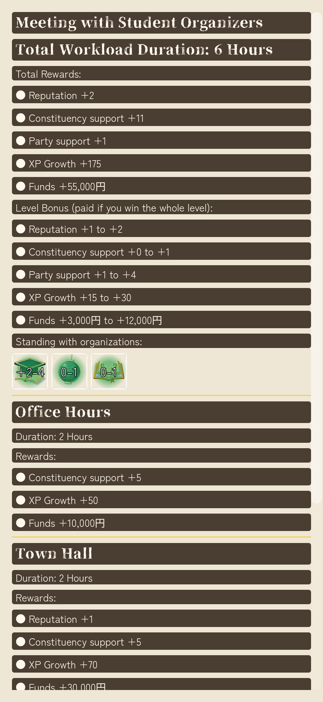
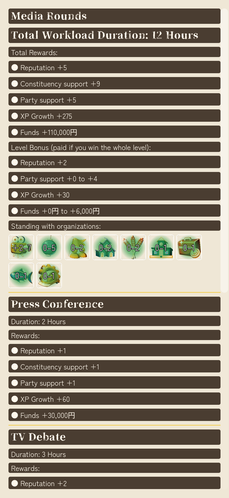

# Outline: show a level's end-of-level bonus in the briefing

Draft for Cameron's approval. **Nothing is built.** Decided 2026-11-19 (Cameron): "Show all of it." This outline says exactly what would be built so you can approve it or change it. Pictures: `design/review/level_bonus_outline_2026-11-19/` (the real briefing, with the proposed block added by hand using the real components; the numbers are typed from `data/levels.json`).

## Executive summary

| Question | Answer |
|---|---|
| What is wrong today | The briefing lists each room's rewards and their total, and **nothing else**. A level also pays a *level bonus* when it is won (money, Constituency support, Reputation, XP, Party support, and standing with organizations), and none of it is shown first. 93 of 114 levels pay one; 69 pay organization standing |
| What changes | A "Level Bonus" block under "Total Rewards": one line per number, as a range when it is a range, then the organization chips with their ranges |
| Honest by construction | The preview reads the same columns, with the same Campaign Pressure scaling, as the payout, and a test checks every payout lands inside its preview |
| Size | About 110 lines of code, 90 lines of tests, 4 Text rows. No schema change, no data change |
| Needs from you | Two small choices (below), then "go" |

## What the player sees: before and after

Typical level (LV11, Meeting with Student Organizers). Today the briefing shows the stage totals and then the three rooms. The proposal adds the block between them:

A heavy case (LV05, Media Rounds: nine organizations):

What the picture shows, and what it does not:

- The organization chips are the real new information. **No briefing shows any organization standing today.**
- The money and XP lines are small next to the stage totals (LV11: stage Funds +55,000円, bonus +3,000円 to +12,000円), so the block is mostly about standing and the "this is paid on top" honesty.
- The chip numbers need a smaller font to sit inside a 120 px chip ("+2-7" is the widest today). That is part of the build.

## The data (checked against `data/levels.json`)

| | Levels |
|---|---|
| Pay money, support, Reputation, XP or Party support **and** organization standing | 50 |
| Pay only the meter numbers | 24 |
| Pay only organization standing | 19 |
| Pay no level bonus | 21 |
| Organization ranges per level (those that have any) | average 2.9, most 10 (LV06) |

Many ranges start at 0 ("0 to +3"), so showing the range, not one number, is the honest preview.

## The design

**Where:** directly under the "Total Rewards" list, before the first room. The bonus is paid once, when the whole level is won, so it sits with the level's totals and not inside any room.

**What it says, in order:**

| Line | Rule |
|---|---|
| Heading | "Level Bonus (paid if you win the whole level):" (Text row, your wording to change) |
| Meter lines | Reputation, Constituency support, Party support, then XP Growth, then Funds last (the briefing's existing order, `BriefingSummary.ordered`). A fixed number reads "+2"; a range reads "+1 to +2". Zero-only lines are left out |
| Funds and XP | **After Campaign Pressure** (`Difficulty.payout`), the same call the payout makes, so the number shown is the number paid |
| Organization line | "Standing with organizations:" then one chip per organization, the existing preview chip (white outline, green for a gain, red for a loss), biggest gain first, losses last. The chip reads its range ("0-3", "+2-4"); a tap shows the organization's name (existing behavior) |
| A level with no bonus | The block is not shown |

**Not previewed (same as the stage rewards today):** backing bonuses you own, a Funding Freeze (which turns Funds income to 0), and standing that other organizations pass along. The heading already says "if you win".

**Related fix:** the briefing says "Nothing in this level pays out yet" when its rooms have no rewards. A level whose only reward is its level bonus would wrongly say that. No level is like that today, but the build counts the bonus as a reward so it cannot happen.

## How it would be built

| Piece | Where | Lines |
|---|---|---|
| `BriefingSummary.level_bonus(level, pressure, balance)`: the pure preview, returning meter ranges and organization ranges | `scripts/rules/BriefingSummary.gd` | about 45 |
| Share the column-to-meter map with the payout so the two cannot drift: the map moves out of `GameState._apply_level_bonus_win` into the new function | `scripts/autoload/GameState.gd` (a small edit) | about 10 |
| `OrgChip.make` takes an optional label (the range) and a smaller font for it; `OrgChip.range_text(low, high)` | `scripts/ui/OrgChip.gd` | about 20 |
| `_level_bonus_rows(level)` and the call in `_show_briefing`, plus the "nothing set" fix | `scripts/ui/OfficeScreen.gd` | about 35 |
| Four Text rows: heading, organization heading, the range line, and the chip range | Text tab via `wbx.py`, then `--accept-wording` | 4 rows |

## Tests

| Test | What it proves |
|---|---|
| New unit test (`test_briefing_level_bonus`) | The preview equals the data for LV05, LV06 and LV11; Funds and XP are scaled by each Campaign Pressure; a level with no bonus gives an empty preview |
| Same test, the honesty check | For a sample of levels, the real payout (`_apply_level_bonus_win`) lands inside the preview, repeated 50 times each, on every Campaign Pressure |
| New real-click test | The briefing for LV11 shows the block with 3 chips; a level with no bonus shows no block; a tap on a chip names the organization |
| Existing checks | The text sweep (three styles, three text sizes) and the style-parity test already open briefings, so a wrapped or clipped line fails the build |
| Docs | `GAME_SYSTEMS.md` (what the briefing shows), `INFORMATION_STANDARDS.md` (a note under Standard 1), `CHANGELOG.md`, `CLAUDE.md` index |

## Risks

| Risk | Handling |
|---|---|
| Ten chips in one block (LV06) | They wrap in a flow row, as in the LV05 picture (nine chips, two rows) |
| Chip label too wide | A smaller font for ranges; checked in the three styles by the sweep |
| Information overload | The block is one heading, up to five short lines and one row of chips, and absent where there is nothing to say |
| The preview drifts from the payout later | One shared column map, and the honesty test |

## Two choices for you

1. **Placement:** under "Total Rewards" (as pictured, recommended), or after the last room.
2. **Chip label:** the range on the chip ("0-3", as pictured, recommended), or only the top ("up to +3").

Say **go** (with your two choices) and I build it on its own branch, run the full checks, and wait for "merge".
