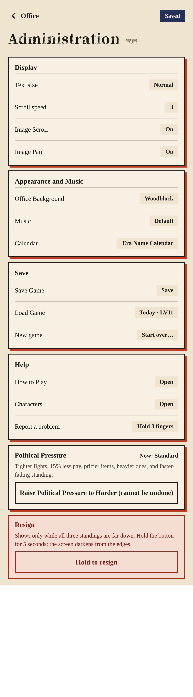
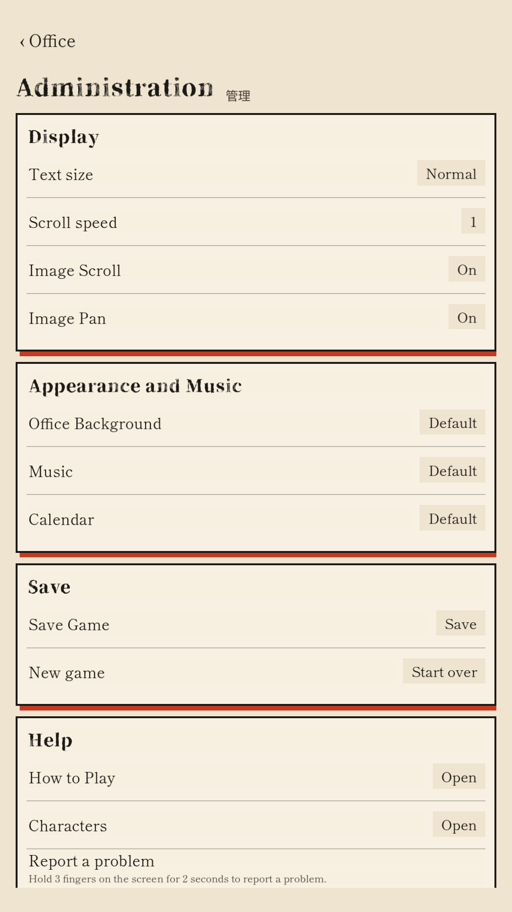
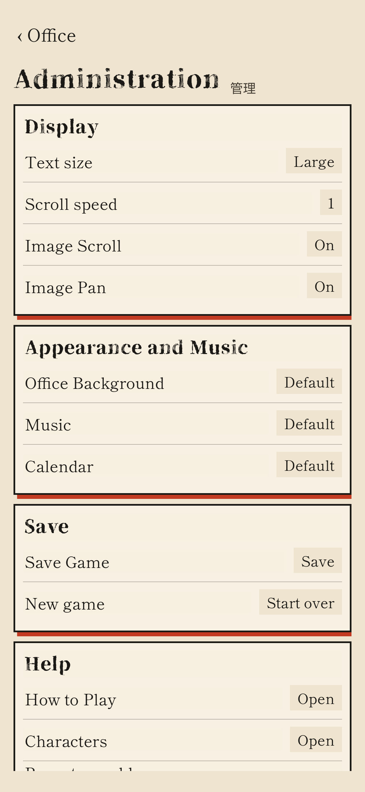
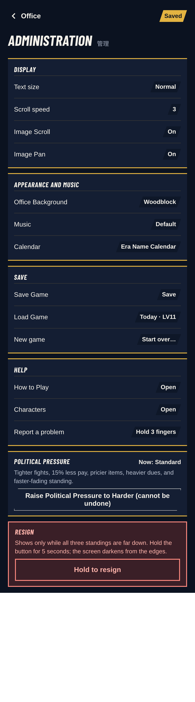
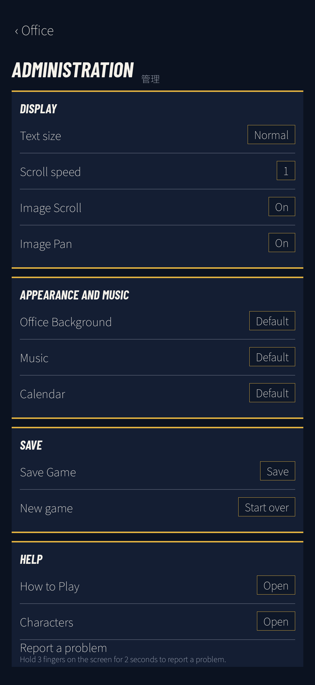
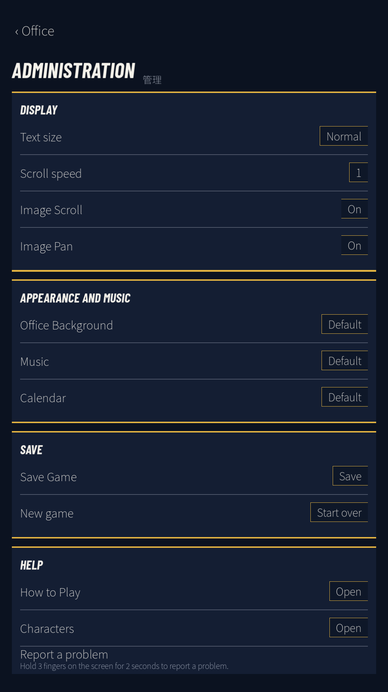
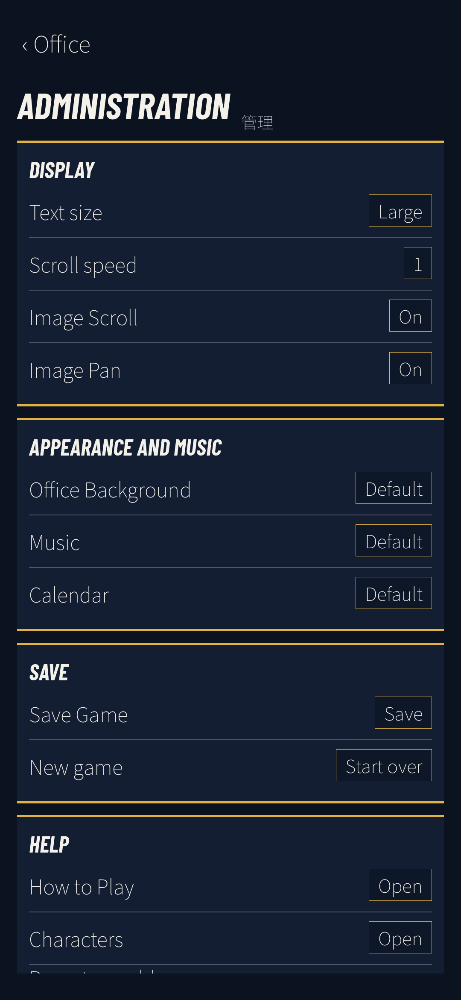
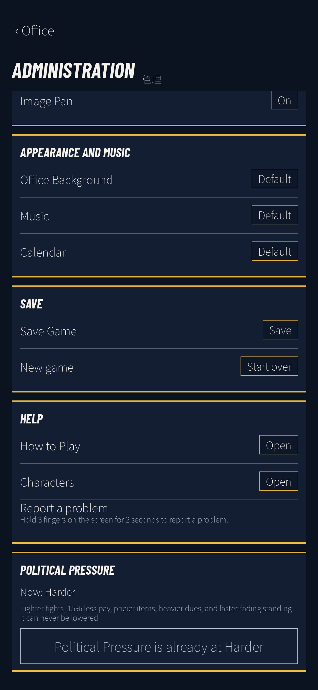

# P13 Office screens: report (draft, grows with each commit)

Branch `panel/p13-office-screens`. Mockups are in `design/proposals/img/office_screens/previews/png/`. Screenshots here are the real game at 1080 x 2340, 1080 x 1920 and Large text, made with `tools/office_screen_shots.tscn` (command in its header).

## Commits

| # | Commit | State |
|---|---|---|
| 1 | The shared frame (`OfficeScreenFrame`, `OfficeFrameStyles`, `Overlay.open_frame`) | Gate passed |
| 2 | Administration | This report; gate pending |

## Your answers

| Question | Answer |
|---|---|
| Branches | Two `panel/` branches |
| Where Resign lives | Stays in Reputation and Results (so it is **not** on the Administration screen) |
| Where it sits on the Overview tab | Top |
| Text rows | Add as written, drafts for you to reword |
| Events "Coming up" reader | Yes |

## Administration (commit 2)

| Style | Mockup | Built (1080 x 2340) | 1080 x 1920 | Large text | Bottom, Political Pressure at Harder |
|---|---|---|---|---|---|
| Woodblock |  |  |  |  |  |
| Living Office |  |  |  |  |  |
| Broadcast |  |  |  |  |  |

### What differs from the mockup, and why

| Difference | Why |
|---|---|
| No "Saved" chip on the top bar | The game keeps no "last saved" state, so the chip would claim something it cannot check. Every button press saves, which the screen does not need to say. Say so if you want the chip. |
| Scroll speed row is new on this screen | The spec's Display group lists it; the old menu only had it in the stage menu. Haptics (also only in the stage menu) is not in the spec's list, so it is not here. |
| Load Game and Undo rows appear only when there is a saved game or something to undo | Exactly as the old menu did. The mockup shows Load Game with a summary chip; the summary text stays in the Load confirmation, as before. |
| The Calendar, Music and Office Background rows all open Appearance and Music | The spec says Calendar opens it; the other two do the same. Music shows Default because no music package exists yet. |
| "Report a problem" is a label with the Reporter's own lines, not a button | It is a gesture (hold three fingers), so a button would promise something it cannot do. The lines come from `Reporter.hint_lines()`. |
| Resign is not shown | Your decision of 2026-11-20. |
| Political Pressure box shows the next tier's blurb | At the top tier it shows the tier in force, as there is no next one. |

### New Text rows (all drafts for you)

| Key | English | Note |
|---|---|---|
| `ui.back_office` | ‹ Office | The back control |
| `admin.group_display` · `admin.group_save` · `admin.group_help` | Display · Save · Help | In the approved list |
| `admin.pressure_now` | Now: {name} | In the approved list |
| `admin.label_text_size` · `admin.label_scroll_speed` · `admin.label_image_scroll` · `admin.label_image_pan` | Text size · Scroll speed · Image Scroll · Image Pan | **Not in the approved list**: the mockup's row labels, separate from their values |
| `admin.chip_open` · `admin.chip_save` · `admin.chip_load` · `admin.chip_undo` | Open · Save · Load · Undo | **Not in the approved list**: the value chips |
| `office.subtitle_jp_administration` | 管理 | **Not in the approved list**: the Japanese accent from the mockup |

### Tests

`tests/test_office_screen_frame.gd` (9) and `tests/test_administration_screen.gd` (11): values equal what the old buttons said, every old node name is kept, a tap runs its action, Resign is not on the screen, Load and Undo follow the save, chips never wrap, the Political Pressure box has one button, and the frame closes by Back and escape. `tests/interaction/image_pan_driver.gd` was updated on purpose: it read the old button's text and now reads the value chip.
